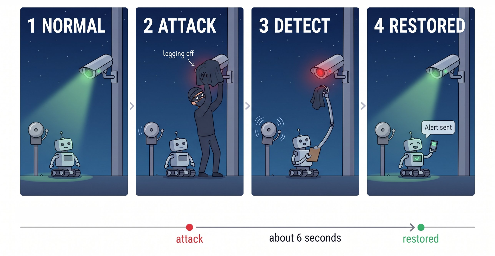
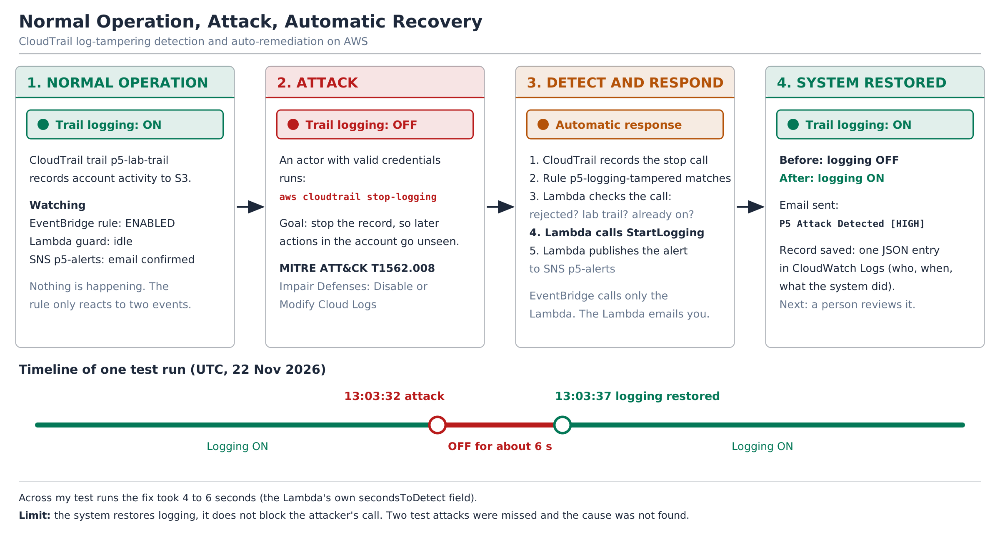
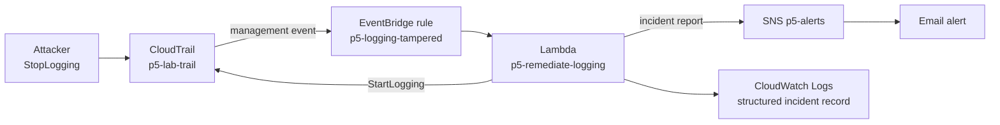
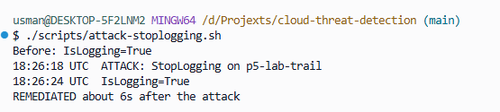
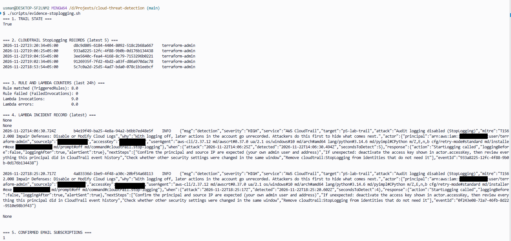
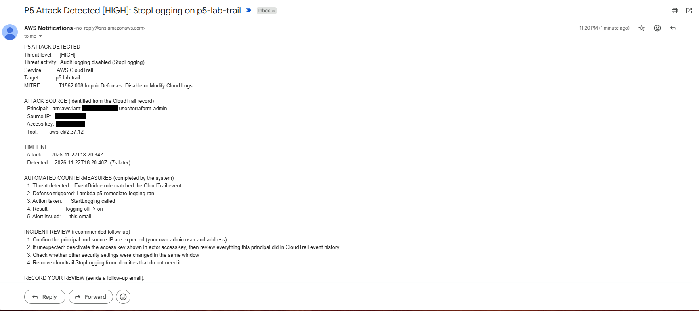
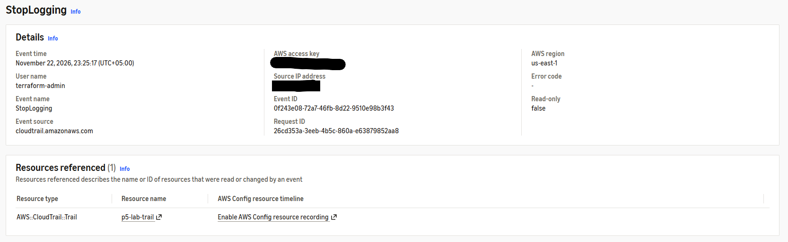
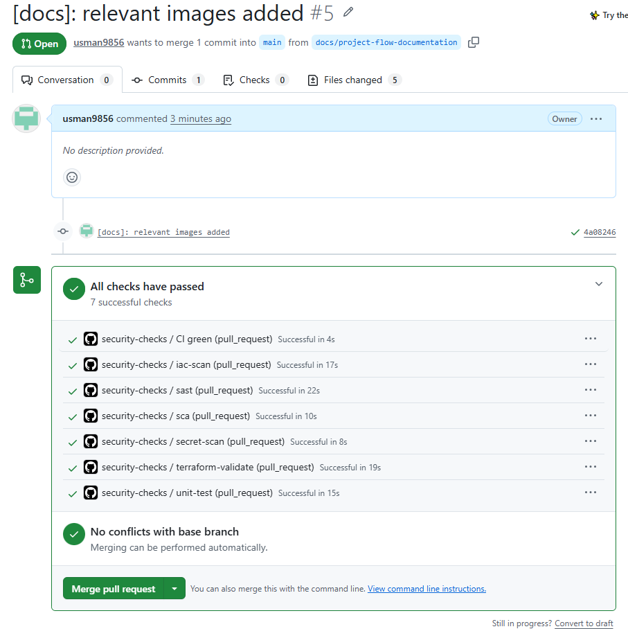

# Cloud Threat Detection and Auto-Remediation (AWS)

[](https://github.com/usman9856/cloud-threat-detection/actions/workflows/security.yaml)

One of the first things an attacker does in a cloud account is switch off audit logging, so nothing they do next is recorded. This project detects that move, **restores logging automatically within seconds**, and emails a structured incident report. The whole system is built from Terraform, and a CI pipeline checks the code on every push.

> **Status:** one scenario (logging tampering) is built and tested end to end: attack, detection, automatic fix, structured log and email alert. The pipeline badge above shows the current CI state. **In testing, some attacks were not fixed and the cause is not found** (see [Troubleshooting](#troubleshooting-some-attacks-were-not-fixed)). The stack has since been destroyed. Nothing in this README claims more than what exists.

## The story in 30 seconds



A camera watches the building. An intruder covers its lens, so nothing is recorded. A bell rings, a robot guard checks the situation, uncovers the lens and sends the owner an alert, all within about 6 seconds.

In AWS terms: the camera is **CloudTrail logging**, the intruder is a `StopLogging` call, the bell is an **EventBridge rule**, the guard is a **Lambda function**, and the alert is an **SNS email**.

## What happens, step by step



The picture above shows one real test run. Across my test runs, logging came back on **4 to 6 seconds** after the attack (the Lambda's own `secondsToDetect` field).

## What this proves

- I can build **detection and automatic response** for a real cloud attack technique and express all of it as code.
- I can make a system **explain itself**: every detection produces a structured record with who, what, how fast, what the system did, and what a person should review.
- I can **investigate a failure from evidence** without guessing, by testing each link of the chain separately.

## What this is

- **CloudTrail trail** `p5-lab-trail` writing to a locked-down S3 bucket (public access blocked, encrypted, 30-day expiry, log file validation on).
- **EventBridge rule** `p5-logging-tampered` that matches `StopLogging` and `DeleteTrail`.
- **Lambda** `p5-remediate-logging` that checks the trail, calls `StartLogging`, builds the incident record and sends the alert.
- **Least-privilege IAM role** for the Lambda: write its own logs, publish to one topic, and `GetTrailStatus` and `StartLogging` on the lab trail and on trails whose name starts with `stratus-red-team-`. No wildcard actions. The one wildcard resource is that trail-name prefix (see Known shortcuts).
- **SNS topic** `p5-alerts` (encrypted) with an email subscription.
- **CI pipeline** that checks the code on every push.

MITRE ATT&CK: **T1562.008** (Impair Defenses: Disable or Modify Cloud Logs). `DeleteTrail` is also detected but is **alert-only**, because `StartLogging` cannot undo a deleted trail.

## Architecture



EventBridge calls only the Lambda. The Lambda sends the email.

## Results

Measured on a stack built entirely from this repo's Terraform (15 resources, since destroyed):

- Logging was restored **4 to 6 seconds** after the attack, from the Lambda's own `secondsToDetect` field.
- The attack script saw logging back on within **6 to 11 seconds**. That figure includes its 3-second polling interval.
- Every fix produced an alert email with severity, who did it, what the system did, and what a person should review.

| | |
|---|---|
| Attack and automatic fix |  |
| One-screen evidence view |  |
| Alert email |  |
| CloudTrail record of the attack |  |

## The incident record

The Lambda writes one structured JSON record per detection to CloudWatch Logs:

| Field | Meaning |
|---|---|
| `severity` | HIGH for StopLogging. CRITICAL for DeleteTrail, or if the fix fails |
| `attack`, `mitre` | What happened and the ATT&CK technique |
| `actor` | Principal, source IP, masked access key, user agent (CLI or console) |
| `when` | Attack time, detection time, `secondsToDetect` |
| `response` | Action taken, `loggingBefore`, `loggingAfter`, `alertSent` |
| `nextSteps` | What a responder should review |

The alert email carries the same facts as a readable report: attack source, timeline, automated countermeasures, and an incident review checklist. `scripts/log-action.sh` records a manual review and sends a follow-up email.

The detection catalog is one lookup table keyed by event name, so a new attack needs one new entry and no handler changes.

## What the pipeline does

`.github/workflows/security.yaml` runs on every pull request and every push to `main`.

| Job | What it checks | Fails the build? |
|---|---|---|
| `terraform-validate` | `terraform fmt -check` and `terraform validate` | Yes, via `CI green` |
| `unit-test` | `npm test`: 9 tests covering fix, idempotency, scope, DeleteTrail, rejected calls, REMEDIATE=false and failure handling | Yes, via `CI green` |
| `iac-scan` | Checkov scans `terraform/` against AWS security benchmarks | Yes, via `CI green` |
| `secret-scan` | gitleaks scans the full history for committed secrets | Yes, via `CI green` |
| `sast` | Semgrep (`p/default`) scans `lambda/` | Yes, via `CI green` |
| `sca` | OSV-Scanner checks dependencies for known CVEs | Yes, via `CI green` |
| `CI green` | Fails unless every job above succeeded | Aggregate check |

The pipeline only checks. It never runs `terraform apply` and needs no AWS credentials.



## Evidence: Checkov

The first Checkov run **failed**: 62 checks passed and 17 failed. The passes include no wildcard IAM actions or resources, a Lambda role that only Lambda can assume, a bucket that blocks public access and is encrypted, and an invoke permission limited by `SourceArn`.

I skipped all 17 in the workflow, in one `skip_check` list with comments by group. Most are production hardening that costs money or adds setup without changing what this lab proves. **Six are real gaps** I would fix in production: the three KMS checks, bucket versioning, the multi-region trail, and log retention.

| Check | What it is | Why skipped |
|---|---|---|
| `CKV_AWS_35` | CloudTrail logs not encrypted with a customer KMS key | Real gap. Key costs money, bucket is already AES256 |
| `CKV_AWS_158` | Log group not KMS-encrypted | Real gap. Lab cost control |
| `CKV_AWS_145` | Bucket uses AES256, not KMS | Real gap. AES256 is enabled |
| `CKV_AWS_21` | Bucket versioning off | Real gap. Bucket is destroyed after each session |
| `CKV_AWS_67` | Trail is not multi-region | Real gap. Lab is single-region by design |
| `CKV_AWS_338` | Log retention under 1 year | Real gap. 14 days chosen for a disposable lab |
| `CKV_AWS_252` | Trail has no SNS topic | Alerting is done by EventBridge and Lambda |
| `CKV2_AWS_10` | Trail not sent to CloudWatch Logs | Extra role and cost. Detection uses EventBridge |
| `CKV_AWS_117` | Lambda not in a VPC | Needs NAT or endpoints to reach AWS APIs, which costs money |
| `CKV_AWS_115` | No reserved concurrency | Can fail on new accounts with low limits |
| `CKV_AWS_173` | Env vars not KMS-encrypted | Variables hold names and ARNs only |
| `CKV_AWS_50` | No X-Ray tracing | Not needed for a single-step function |
| `CKV_AWS_116` | No dead-letter queue | The alert is sent synchronously and failures raise an error |
| `CKV_AWS_272` | No code signing | Out of scope for the lab |
| `CKV_AWS_144` | No cross-region replication | Lab bucket |
| `CKV_AWS_18` | No access logging on the log bucket | Lab bucket |
| `CKV2_AWS_62` | No S3 event notifications | Not used |

## Troubleshooting: some attacks were not fixed

**Symptom:** during testing on 22 November 2026, CloudTrail recorded some `StopLogging` calls that the rule never matched. For those, the Lambda never ran, so nothing restored logging automatically.

**What I checked, one link at a time:**

| Check | Result |
|---|---|
| Rule state and pattern | `ENABLED`, correct pattern |
| Rule target | Points at the Lambda |
| Invoke permission | Present for `events.amazonaws.com` |
| `terraform plan` | No drift from the code |
| Lambda called directly with a sample event (`scripts/test.sh`) | Worked, logged a clean record |
| Rule `TriggeredRules`, `FailedInvocations` | 0 and 0 for the missed attack |
| Lambda `Invocations`, `Errors` | The missed attack never reached the Lambda, 0 errors |
| CloudTrail history of rule and function changes, last 24h | Stack destroyed 17:37 and rebuilt 17:52 PKT. No attack fell in that gap. No disable or enable events, and one PutRule (the rebuild) |
| All `StopLogging` events compared with the Lambda incident records by event ID | Some reached the Lambda, some did not |

**What this shows:** the Lambda was healthy, and for each miss the rule never matched the event, so the fault was between CloudTrail and the rule. Attacks were missed both before and after I destroyed and rebuilt the stack (17:37 to 17:52 PKT). None fell in the gap when the rule did not exist. Some of the post-rebuild misses came within about two minutes of a Lambda code update, but others did not, so I could not tie the misses to updates.

**What I do not know:** the cause. I did not find a reason, and I did not try to fix it by guessing. Detection did not fire for every attack, so I do not call it reliable. I destroyed the stack afterwards, so the cause was not tested.

**What I'd do next time:** run one attack and wait 10 minutes before judging it, to separate a late event from a lost one.

## Repo layout

| File | Purpose |
|---|---|
| `terraform/main.tf` | Trail, log bucket, SNS topic and subscription, Lambda, IAM role and policy, rule, target and permission |
| `terraform/variables.tf` | Region, alert email, detection and remediation switches, log retention |
| `terraform/versions.tf` | Provider versions |
| `terraform/outputs.tf` | Trail name, topic ARN, Lambda name, rule state |
| `lambda/stop-logging/index.mjs` | Detection catalog, the fix, the incident record and the alert email |
| `tests/` | Unit tests and a sample StopLogging event |
| `scripts/attack-stoplogging.sh` | Runs the attack and times the automatic fix |
| `scripts/attack.sh` | Older attack script with 30-second polling, kept for reference |
| `scripts/evidence-stoplogging.sh` | One-screen, read-only evidence view: trail state, CloudTrail records, rule counters, Lambda record |
| `scripts/logs-stoplogging.sh` | Prints the Lambda logs readably, with colored levels and severity |
| `scripts/log-action.sh` | Records a manual review and sends a follow-up email |
| `scripts/test.sh` | Sends the sample event straight to the Lambda |
| `scripts/check.sh` | Shows whether the stack is deployed |
| `scripts/cleanup.sh` | Destroys the stack with Terraform |
| `.github/workflows/security.yaml` | The pipeline |
| `docs/diagrams/` | The storyboard (`story.png`) and the incident diagram (`incident-story.png`, with its editable `.svg`) |
| `docs/screenshots/` | Evidence screenshots used in this README |

## Run it yourself

You need an AWS account, the AWS CLI, Terraform 1.6 or newer, and Node 22.

```bash
# 1. Put your email in terraform/terraform.tfvars (gitignored)
echo 'alert_email = "you@example.com"' > terraform/terraform.tfvars

# 2. Build
cd terraform
terraform init
terraform plan -out=tfplan
terraform apply tfplan        # then click the SNS confirmation link in your email
cd ..

# 3. Attack and read the result
./scripts/attack-stoplogging.sh
./scripts/logs-stoplogging.sh 1 app

# 4. Tear down so nothing keeps costing money
./scripts/cleanup.sh
```

Run `terraform -chdir=terraform ...` commands from the repo root, not from `scripts/`. CloudTrail and IAM events are delivered in `us-east-1`. Never commit `terraform.tfstate`, `terraform.tfvars`, `tfplan` or `evidence/`. The `.gitignore` excludes them.

## What I've learned

- **State is the link between code and the live stack.** When I lost the state file, `terraform destroy` reported nothing to destroy while the old stack kept running. I removed it by name and rebuilt from the code.
- **Isolate each link.** Calling the Lambda directly proved the code worked, which put the fault in the rule.
- **A green run and a working system are different things.** The unit tests passed the whole time the rule was missing events.
- **`terraform apply` can hide the evidence.** It switches logging back on, so running it during an attack test makes the Lambda's fix impossible to tell from Terraform's.
- **Copied workflows break on paths.** The earlier project's workflow scanned folders that don't exist here, which would have passed without checking anything.
- **Scanner defaults target production.** 17 of 79 checks failed on a small lab stack. Each skip needs a written reason.
- **Measure what the system reports, not the script's clock.** The attack script's timestamp can lag by a minute because the CLI call is slow. The log's `secondsToDetect` is the honest number.
- **An alert that says what to do is more useful than one that says what happened.** The first version logged only the facts, with no severity and no next steps.

## Known shortcuts (lab, not production)

- The Lambda role also has `StartLogging` on any trail named `stratus-red-team-*`, a leftover from an earlier plan to test with Stratus Red Team. Only `p5-lab-trail` exists in this stack. In production, scope it to exact trail ARNs.
- One admin user (`terraform-admin`) deploys the stack and also runs the attack, so the principal in every record is my own.
- Remediation restarts logging but cannot tell whether the actor was legitimate. A person must review each incident.
- The alert email contains the principal, source IP and a masked access key, and goes to one confirmed address.
- Terraform state is local. A team setup would use a remote backend with locking.
- The log bucket uses `force_destroy = true` so `terraform destroy` works cleanly.
- Encryption uses AWS-managed keys, not customer-managed KMS keys.
- Only one scenario is built. It is not a full detection suite.
- GitHub Actions are pinned by version tag, not commit SHA, and the Semgrep container image is not pinned. OSV-Scanner is pinned to v2.3.8.

## Hardening next

- Restrict who can read the logs: a separate read role with MFA, and KMS encryption.
- Fix the six real Checkov gaps instead of skipping them.
- Add more detection scenarios to the same catalog.